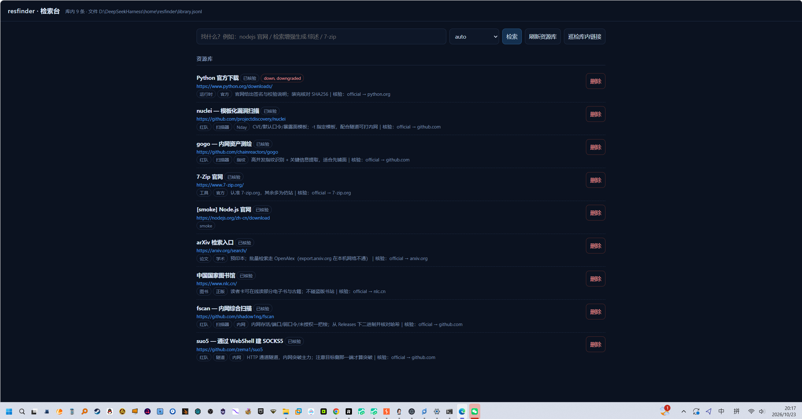

# dsh-resfinder

判断一个链接能不能用，以及它什么时候会坏掉。

DeepSeek Harness 插件，同时带 CLI 和 MCP 服务。不装依赖，`node` 能跑就行。

搜索有专门的插件在做（[dsh-free-search](https://www.npmjs.com/package/dsh-free-search)、[@liustack/modsearch](https://www.npmjs.com/package/@liustack/modsearch)），这个插件只管搜到之后的事。

## 为什么需要它

搜索结果里排前面的经常是仿冒站，官网会换域名，发布页过一阵就 404。名字对、页面像，点进去下载——这是找资源最容易踩的坑，人和 agent 都一样。

## 三个主要工具

**`res_verify`** — 跟着跳转链走到底，看最终落在哪个域名，再看 TLS 证书，给一个档位：`official` / `trusted` / `unknown` / `suspicious`。每个结论都带判据，不是一句"安全"。

加 `fromPage` 可以体检整个页面：把教程页里的外链全抓出来逐条核验，可疑的排在最前面。文章往往没问题，它给的下载链接才是问题。

**`res_channels`** — 报一个资源名，直接给官方入口：官网、GitHub Releases、应用商店、正版书库。目前登记了 25 条，没登记的会给出检索式，不会瞎猜链接。

**`res_watch`** — 拿库里的链接再过一遍，跟上次比，只报变化：挂了、落地域名换了、可信档位掉了、证书不对了。

另外还有 `res_read`（读网页正文，B 站、豆瓣、arXiv、GitHub 仓库有专门的解析）、`res_save` / `res_library`（存和查）、`res_sources`（看当前哪些源能用）。

## 截图



`http://127.0.0.1:3080/resfinder`

## 三个入口

DSH 里是一组 `res_*` 工具，命令行是 `resfinder`，MCP 是 `mcp/server.js`。三者共用同一份 `lib/`，行为一致。

```bash
npm i -g dsh-resfinder

resfinder verify https://bit.ly/xxx
resfinder channels nodejs
resfinder watch --limit 50 --json
```

所有命令都支持 `--json`，正文走 stdout，错误走 stderr，失败退出码非 0。

## 几个设计选择

**只看能验证的东西。** 跳转链、落地域名、证书，这三样是客观的。域名白名单只用来定档位，"页面看着像官网"不作为证据。入口可疑、落地地址又不认识，就还是可疑——不会因为跳转一次就洗白。

**记忆分两层。** 搜索结果在缓存里放一会儿（检索 30 分钟，读页 6 小时），过期就不算命中；资源库是另一回事，只放核验过的东西。两层的语义不混。

**告警少报一点。** 连接失败先等 700 毫秒重试一次，还是不行才判挂掉。误报几次之后，就没人看告警了。

**失败就说失败。** B 站搜索被风控会直接报错，不会显示成"没找到"。

## 网络环境

免 key 能用的：Bing、360、GitHub、npm、crates.io、Stack Overflow、哔哩哔哩、OpenAlex、Crossref。

直连不通的：DuckDuckGo、公共 SearXNG、`export.arxiv.org`。

需要 key：Tavily、Brave。另外 `GITHUB_TOKEN` 能把 GitHub API 配额从 60 次/小时提到 5000。

## 许可

MIT。
